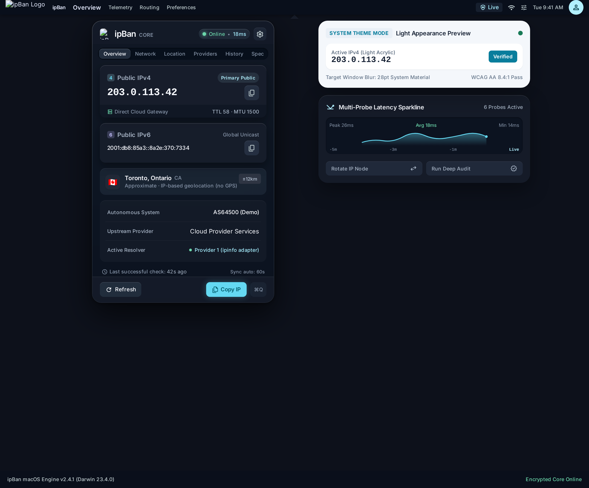
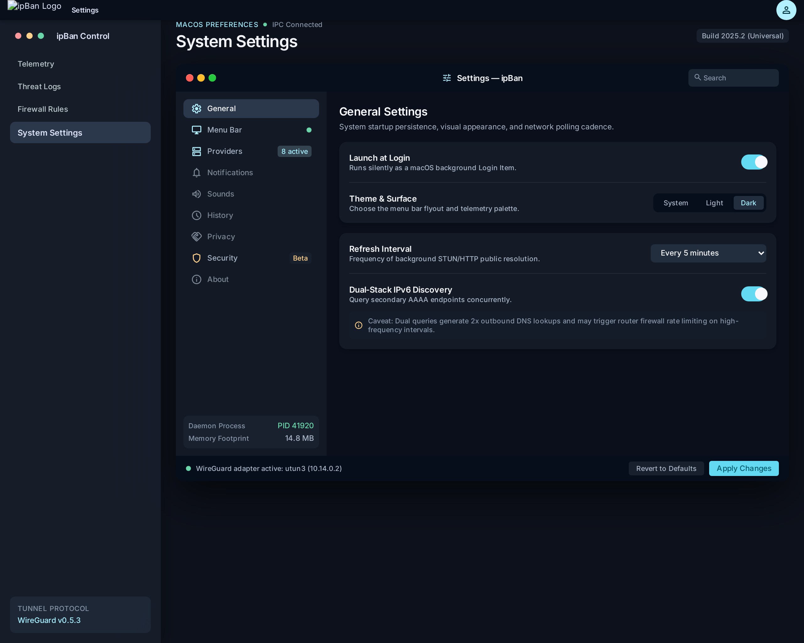
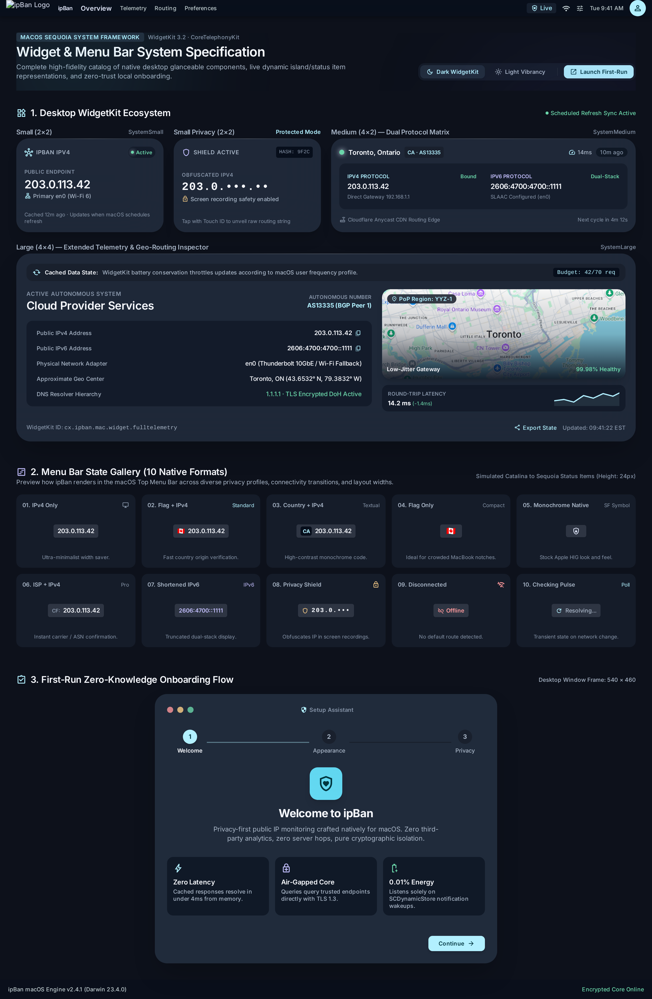

# IpBan for macOS

[فارسی](README.fa.md) | English


*Concept artwork, not a screenshot of the application.*

Formerly IP Prism. A native menu bar companion that puts your public connection in focus. Built with Swift 6, SwiftUI, Network.framework, and WidgetKit. macOS 14 or newer; no account or API key required for the basic provider flow.

**Development preview.** The macOS build and a settings-window open/close/reopen smoke test passed in CI. Widgets, permissions, visual behavior, and installation still need hands-on Mac validation. The screenshots below are Stitch design mockups, not captures of the running app. The portable Swift core has 16 deterministic tests.

## Features implemented

- Stitch-inspired frosted popover with separate IPv4 and IPv6 cards and Overview, Network, Location, Providers, History, and Designer sections.
- Eight provider adapters, optional fields, automatic fallback or manual selection, priority and enable controls.
- Timeouts, jittered backoff, Retry-After, cooldowns, circuit breaker, budgets, deduplication, caching, cancellation, and health diagnostics.
- Normalized IPv4/IPv6, independent family comparison, two-observation change confirmation, IPv6-only discovery (enabled by default).
- Network-change debounce, sleep/wake scheduling, offline cache, configurable polling.
- Local history with retention, search, JSON/CSV export, and deletion.
- Contextual notifications, permission state, quiet hours, privacy mode, and synthesized original sounds.
- Login-item controls using SMAppService; Keychain storage for an optional IPinfo token.
- Small, medium, and large desktop widgets using sanitized App Group state.
- Adjustable menu bar formatting, native monochrome symbol, adaptive light/dark glass surfaces, and optional three-step onboarding.

See [known limitations and verification](Documentation/VALIDATION.md) before relying on the preview.

## Stitch design references

The supplied Stitch project provided these concept artboards and HTML exports. They are design references, not screenshots of the shipping application; example IP addresses and diagnostics in the mockups are illustrative.

| Popover | Settings | Widgets and onboarding |
| --- | --- | --- |
| [](Documentation/Stitch/popover.png) | [](Documentation/Stitch/settings.png) | [](Documentation/Stitch/widget-onboarding.png) |

The [Stitch design brief](Documentation/Stitch/ipBan_STITCH_DESIGN.md) and exported [popover](Documentation/Stitch/popover.html), [settings](Documentation/Stitch/settings.html), and [widget/onboarding](Documentation/Stitch/widget-onboarding.html) HTML are included for design reference. The shipping app uses native SwiftUI and WidgetKit rather than these HTML files. A real app screenshot has not been captured yet.

## Install

Download a successful build from [Releases](https://github.com/no1onePerson/display-ip/releases). The renamed app is packaged as `IpBan.dmg` and `IpBan.zip`; open the DMG and drag **IpBan.app** to **Applications**. Older releases are named IP Prism.

Read the release's signing status. Development artifacts are ad-hoc signed, not Apple-notarized; Gatekeeper can block them. Do not disable Gatekeeper. Signed distribution requires the provisioning and notarization setup described in [Release instructions](Documentation/RELEASE.md).

Add desktop widgets using macOS **Edit Widgets → IpBan**. Keep the application running to refresh cached data. WidgetKit controls delivery timing; widgets are not continuously live. Both targets must have the same provisioned App Group for reliable sharing.

## Development

Open `macOS/IPPrism.xcodeproj` in Xcode 16.4 or newer. Choose the IPPrism scheme and your team. Register or replace the app and widget identifiers and shared App Group before signing. The generated project is committed and has no third-party runtime dependencies.

```sh
# Portable core, on macOS or Linux with Swift 6:
swift test --package-path macOS

# Reproduce the committed project (Python 3):
python3 Scripts/generate-project.py

# Build both native targets on macOS:
xcodebuild -project macOS/IPPrism.xcodeproj -scheme IPPrism \
  -configuration Debug -derivedDataPath macOS/build CODE_SIGNING_ALLOWED=NO build
```

The project generator is the source of truth for bundle identifiers, version, entitlements, and file membership. Run it after adding native source files. App icon artwork can be regenerated with `python3 Scripts/generate-icon.py` (development-only dependency: Pillow).

## Privacy and providers

No analytics SDK, account, precise location permission, Accessibility permission, or privileged helper. Contacted providers necessarily receive your public IP. History and the latest lookup are stored locally; widgets receive a sanitized cache. IP-based location is approximate and does not establish a person's physical position.

Adapters: **IPWho.is, IPinfo, ipapi.co, GeoJS, FreeIPAPI, ipify, icanhazip, Cloudflare Trace**. Their capabilities differ; discovery-only services do not supply city/ISP details. Providers' current terms and quotas require live verification before stable distribution. [Provider reference](Documentation/PROVIDERS.md) · [Privacy policy](PRIVACY.md).

## Troubleshooting

- **No result:** check Providers for failures/cooldowns. Free endpoints may rate-limit or change behavior. Last successful data remains visible.
- **No IPv6:** check that separate IPv6 discovery is enabled; your network must support IPv6. Missing IPv6 is not a confirmed change.
- **No notifications:** enable them in Settings, grant macOS authorization, and check quiet hours and event toggles.
- **Login approval required:** open the system Login Items page from Settings.
- **Widget empty:** launch the app, complete a successful lookup, and verify matching App Group provisioning for both bundles.
- **No location or ISP:** the responding provider may not supply those fields.
- **Release build failed:** inspect [Actions](https://github.com/no1onePerson/display-ip/actions); artifact creation is gated on a successful build.

The earlier Node prototype remains as historical source; it is not part of the native build.

## Contributing

See [CONTRIBUTING.md](CONTRIBUTING.md), [architecture](Documentation/ARCHITECTURE.md), and [security policy](SECURITY.md). MIT licensed. No commercial Apple assets or third-party sound recordings are included.

## Designer handoff and kill switch

The app includes a copyable Designer tab. Share [the full designer handoff](Documentation/DESIGNER-HANDOFF.md) without exposing connection data. A system-wide internet kill switch is **not implemented**; see [kill switch requirements and limitations](Documentation/KILL-SWITCH.md).
